# The Diligent Shadow

WebGL re-creation of Koya Endo's installation _The Diligent Shadow_ (Tokyo Prototype 2026), from [this reel](https://www.instagram.com/reel/DdJPF6HNMod/) by @braveduckandrobots.

**Live:** [mpts.ie/games/thedilligentshadow](https://mpts.ie/games/thedilligentshadow/) · **Roblox version:** [`roblox/`](roblox/)

| Close-up | Walking to the switch |
|---|---|
| 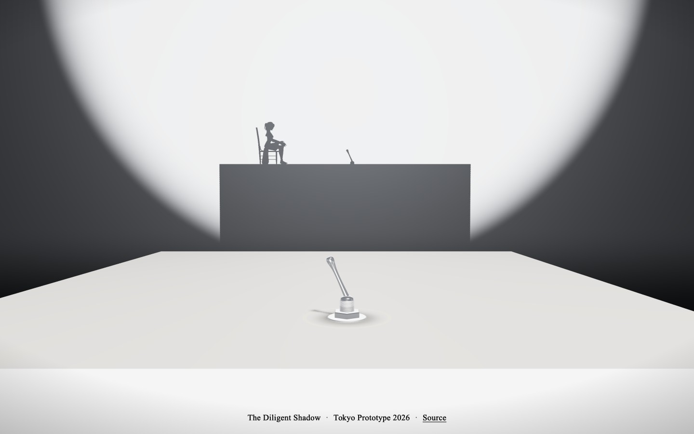 | 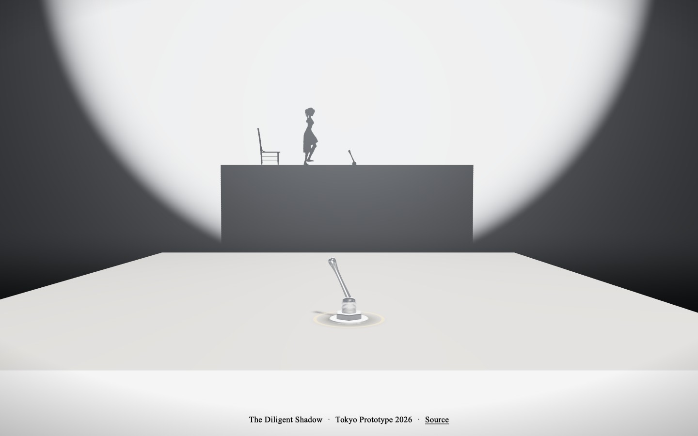 |

| Kick | Lamp off |
|---|---|
| 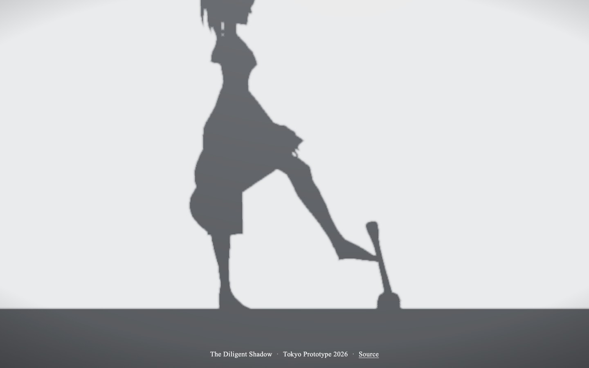 | 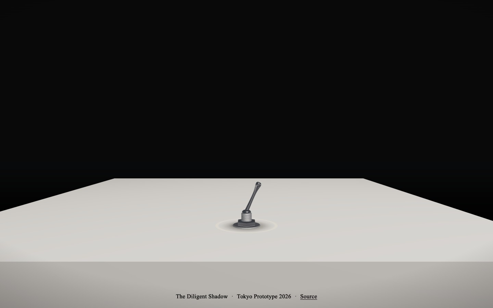 |

| Holding the switch | Kick does nothing |
|---|---|
| 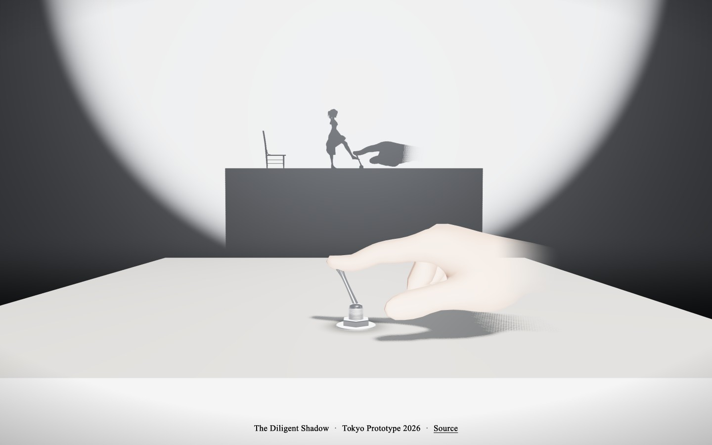 | 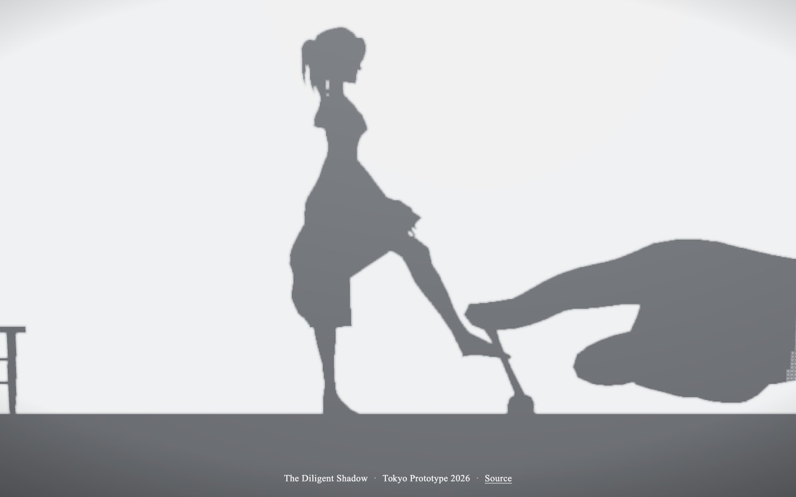 |

| Push | Fake |
|---|---|
| 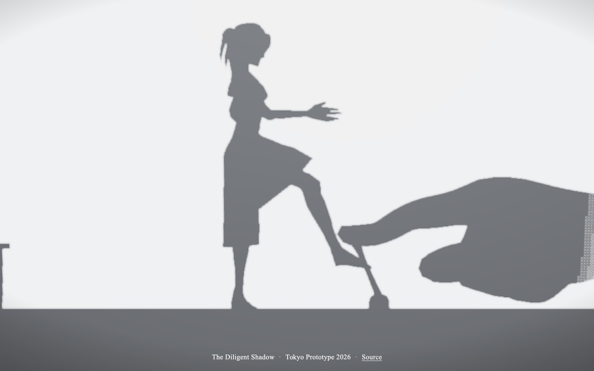 | 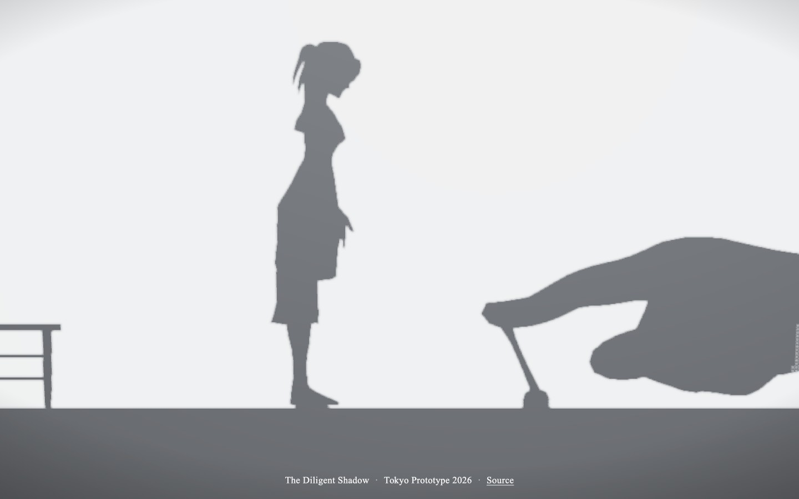 |

| Sulking | Whole room |
|---|---|
| 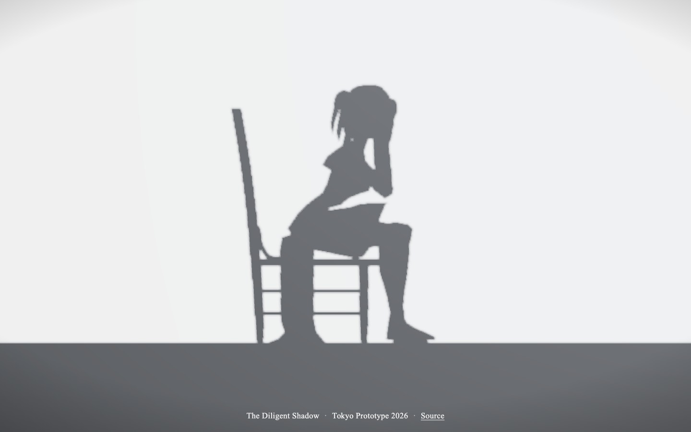 | 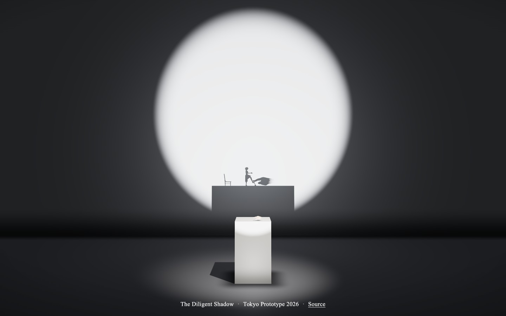 |

| Switch | Phone |
|---|---|
| 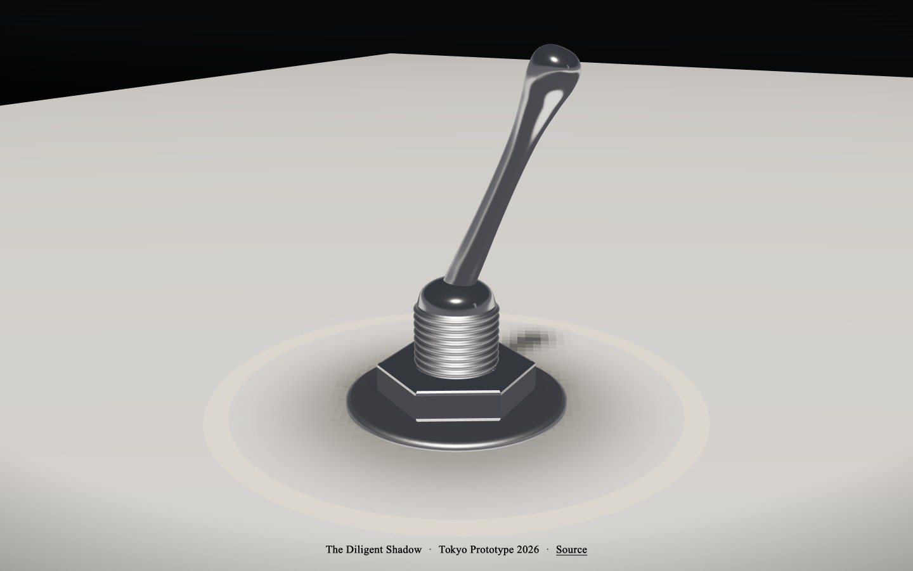 | 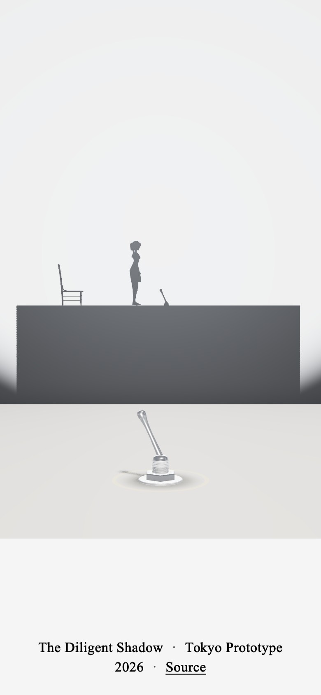 |

## Controls

| Input | Action |
|---|---|
| Drag the switch left, or `Space` | Turn the lamp on |
| Click the pedestal, or `Enter` | Zoom between the close-up and the whole room |

## Running it

```bash
cd public && python3 -m http.server   # then open /games/thedilligentshadow/
```

## License

The code is [MIT](LICENSE). The idea, the interaction and the installation are Koya Endo's and are not covered by it.

| Asset | Source | Licence |
|---|---|---|
| Hand | [WebXR Input Profiles](https://github.com/immersive-web/webxr-input-profiles), © 2019 Amazon | MIT |
| Figure | "Animated Woman" by [Quaternius](https://quaternius.com/) | CC0 |
| Chair | "Painted Wooden Chair 02" by Kirill Sannikov, [Poly Haven](https://polyhaven.com/) | CC0 |
