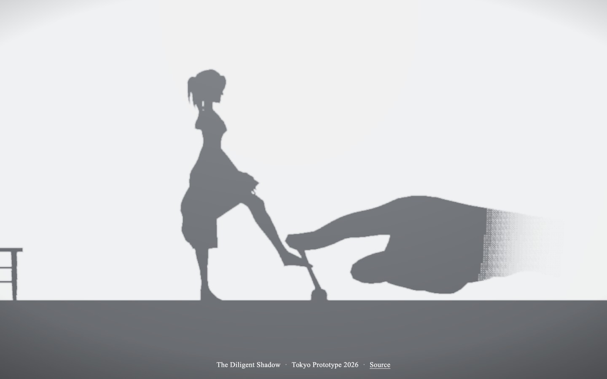
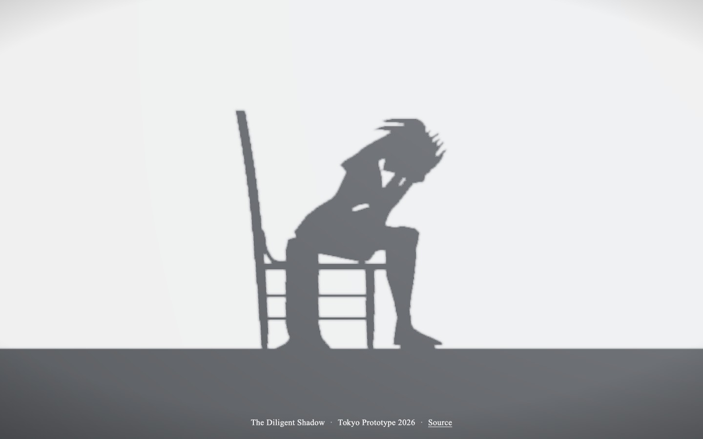
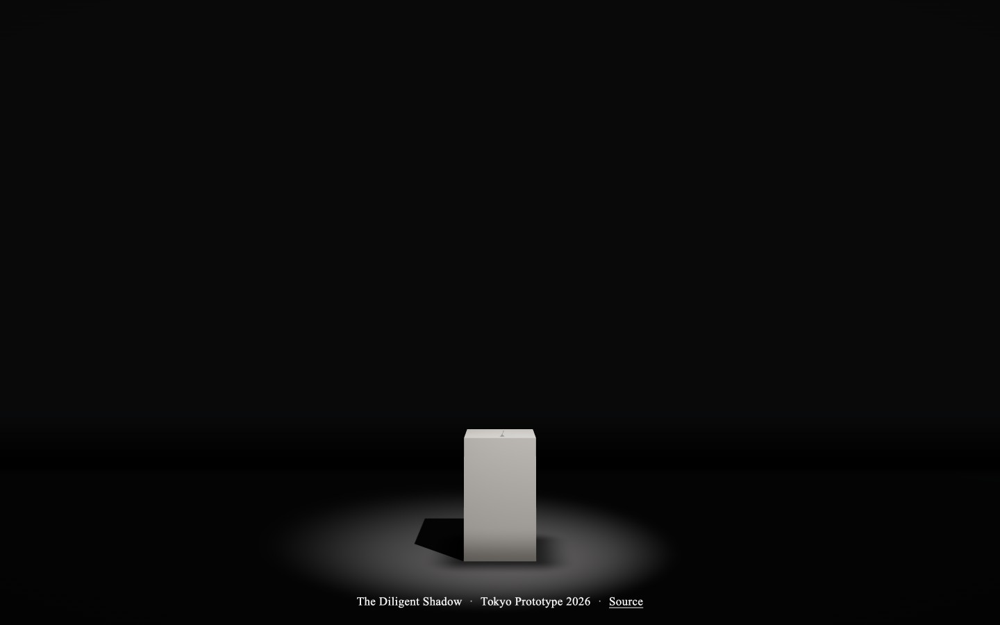
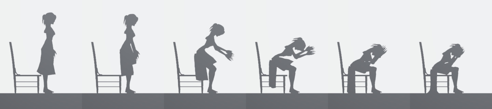

# The Diligent Shadow

A WebGL re-creation of **Koya Endo's** interactive installation **_The Diligent Shadow_**, shown at **Tokyo Prototype 2026** in Japan.

**Play it:** [mpts.ie/games/thedilligentshadow](https://mpts.ie/games/thedilligentshadow/)



## The original

_The Diligent Shadow_ is by **Koya Endo**, exhibited at **[Tokyo Prototype 2026](https://www.instagram.com/tokyoprototype.jp/)** in February 2026. A small toggle switch sits on a white plinth. Flip the switch on and a small shadow figure on the wall kicks it back off. Hold the switch down and the kicks do nothing; after a few tries the figure seems to give up.

This project only re-creates the piece as an homage. The idea, the interaction and the installation are Koya Endo's. It was built from footage of the installation in a reel posted by [@braveduckandrobots](https://www.instagram.com/reel/DdJPF6HNMod/).

## How to play

- **Drag the switch** on the plinth to the left to turn the lamp on. Keep holding it and she can't kick it off.
- **Click the pedestal** to zoom between the close-up and the whole room.
- **Space** flips the switch. **Enter** zooms.

She has a mind of her own. She takes a moment before getting up, sometimes leans on the lever with her foot instead of kicking it, sulks with her head (or chin) in her hands when she gives up, and occasionally jumps up and dashes at the switch just to see what you'll do. If the lamp goes off she walks back to her chair in the dark; turn it back on mid-walk and you'll catch her. Keep flipping it while she walks back and forth and she'll stop and stamp her feet.

## Screenshots

| | |
|---|---|
|  |  |
| The close-up: the switch on the plinth, her shadow on the wall | She gets up and walks to the switch |
|  |  |
| Her toe meets the lever's shadow, and the real switch snaps off | The room goes dark |
|  |  |
| Your hand holds the switch on | Her kicks do nothing |
|  |  |
| Sometimes she leans on it instead, knee bent | A fake: she dashes over and stops short |
|  |  |
| Giving up, chin in hands, watching the switch | Giving up, head in hands |
|  |  |
| The whole room | The whole room, lamp off |



<p align="center">
  
  
</p>

## How it works

- **Real shadows.** The figure, her hair and cloak, the chair, the switch and your hand are all 3D objects lit by one lamp. The figure and chair are invisible to the camera and only cast shadows, so everything on the wall matches in tone and softness.
- **Planted-foot animation.** Her walk follows clinical gait timing (heel strike, foot flat, toe-off, swing). Planted feet are fixed points and each leg is solved in 3D to reach them, so feet don't slide while walking, turning on the spot (a three-step turn), kicking or sitting down.
- **Cloth.** Her hair and cloak are verlet cloth on fixed 240 Hz sub-steps, pinned to skin vertices so the cloak sits snug on her back.
- **Your hand** is a skinned WebXR hand: the fingertip goes exactly where it's sent and the rest of the hand sways around it on springs. It fades out at the wrist, and its shadow fades with it.
- **The credit line** is drawn by a shader pass that inks each pixel black or white depending on the scene behind it.

Built with [three.js](https://threejs.org/) r128. No build step for the page itself: it's plain HTML and JavaScript in [`public/games/thedilligentshadow/`](public/games/thedilligentshadow/).

## Assets and licences

| Asset | Source | Licence |
|---|---|---|
| Visitor's hand | [WebXR Input Profiles](https://github.com/immersive-web/webxr-input-profiles) generic hand, © 2019 Amazon | MIT ([licence](public/games/thedilligentshadow/assets/LICENSE-webxr-hand.md)) |
| Figure | "Animated Woman" by [Quaternius](https://quaternius.com/) | CC0 |
| Chair | "Painted Wooden Chair 02" by Kirill Sannikov, [Poly Haven](https://polyhaven.com/) | CC0 |
| three.js | [threejs.org](https://threejs.org/) (loaded from a CDN) | MIT |

## Development

Deployed as a static-assets Cloudflare Worker with the [`cf` CLI](https://www.npmjs.com/package/cf), on the route `mpts.ie/games/thedilligentshadow*`.

```sh
npm install
cf dev       # local server
cf deploy    # build and deploy
```

mpts.ie itself is [BannerAndLogo](https://github.com/nassir90/BannerAndLogo) on `mpts.ie/*`; this route is more specific, so it wins. The Diligent Shadow is listed on the games index, [mpts.ie/games](https://mpts.ie/games/), and has a stack of clips on the home page (BannerAndLogo's `site/games/index.html` and `site/index.html`), so a changed route needs updating there too.
